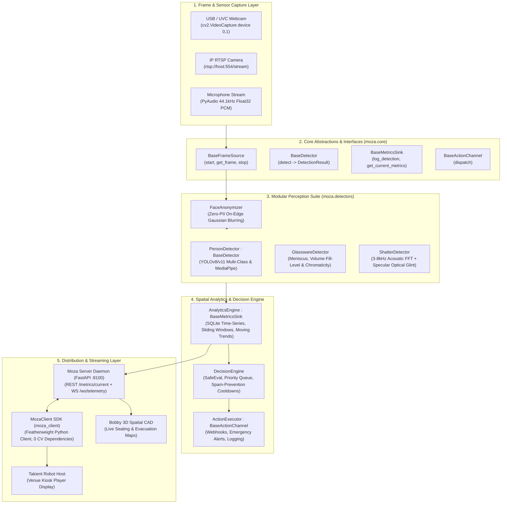
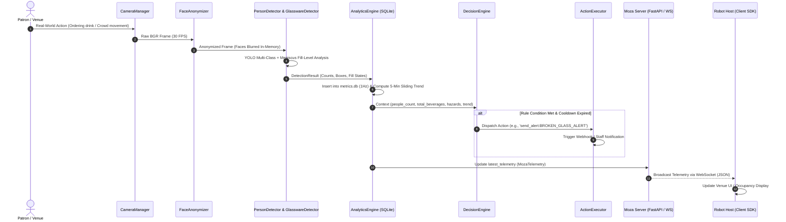

# Moza System Architecture & Engineering Principles

> **Reference Guide**: SOLID & DRY Implementation, End-to-End Pipeline, and Extensibility Blueprint  
> **Target Audience**: Core Maintainers, Open-Source Contributors, and Systems Architects

---

## 🏛️ Executive Architectural Topology

Moza is an offline-first, edge-accelerated computer vision and spatial intelligence engine. It transforms raw video and acoustic streams into typed, actionable spatial telemetry without retaining biometric data or raw frames.



---

## 📐 Adherence to SOLID Principles

Every component in Moza adheres to the five core SOLID principles:

### 1. Single Responsibility Principle (SRP)
Each class has a single, strictly bounded reason to change:
- [`CameraManager`](src/moza/capture/camera.py): Responsible *only* for low-latency frame acquisition and buffer management. Does not process, detect, or record.
- [`VideoRecorder`](src/moza/capture/recorder.py): Responsible *only* for segment file rotation, video writing, and disk retention cleanup.
- [`PersonDetector`](src/moza/detectors/detector.py): Responsible *only* for visual bounding box inference.
- [`GlasswareDetector`](src/moza/detectors/glassware.py): Responsible *only* for liquid meniscus boundary extraction and fill-level regression.
- [`ShatterDetector`](src/moza/detectors/shatter.py): Responsible *only* for brittle fracture frequency and specular glint evaluation.
- [`AnalyticsEngine`](src/moza/analytics/engine.py): Responsible *only* for time-series persistence and sliding-window statistics.
- [`DecisionEngine`](src/moza/rules/decision_engine.py): Responsible *only* for rule condition evaluation and cooldown timers.
- [`ActionExecutor`](src/moza/actions/executor.py): Responsible *only* for side-effect dispatch (webhooks, alerts, logging).

### 2. Open/Closed Principle (OCP)
The system is open for extension, but closed for modification:
- **Adding new detectors**: Any developer can create a custom detector (e.g. `RTDETRDetector`, `ThermalCameraDetector`) by implementing the [`BaseDetector`](src/moza/core/interfaces.py) interface without touching existing detector code.
- **Adding new operational rules**: New venue rules are configured dynamically in JSON ([`configs/rules/`](configs/rules/)) without writing or compiling any Python code.
- **Adding new action handlers**: Custom action sinks (e.g. Slack, MQTT, Philips Hue lighting) are registered dynamically via `decision_engine.register_action_handler("mqtt", custom_handler)`.

### 3. Liskov Substitution Principle (LSP)
Subtypes are drop-in replaceable for their abstractions:
- [`PersonDetector`](src/moza/detectors/detector.py) implements [`BaseDetector`](src/moza/core/interfaces.py). Callers (like `moza.cli` or `services.moza_server`) interact solely with the `.detect(frame)` contract. A test suite can swap in a mock detector with zero regression.
- [`CameraManager`](src/moza/capture/camera.py) implements [`BaseFrameSource`](src/moza/core/interfaces.py). It can be substituted with a file streamer, RTSP pipeline, or synthetic generator seamlessly.

### 4. Interface Segregation Principle (ISP)
Interfaces are small, cohesive, and client-specific:
- Consumers needing video frames depend only on [`BaseFrameSource`](src/moza/core/interfaces.py) (`get_frame()`), not on recording or compression methods.
- Consumers needing object detection depend only on [`BaseDetector`](src/moza/core/interfaces.py) (`detect()`).
- Consumers needing persistence depend only on [`BaseMetricsSink`](src/moza/core/interfaces.py).

### 5. Dependency Inversion Principle (DIP)
High-level modules depend upon abstractions, not concrete implementations:
- The streaming server and CLI depend on the contracts defined in [`src/moza/core/interfaces.py`](src/moza/core/interfaces.py).
- Downstream clients (like `robot_host`) interact via [`MozaClient`](clients/python/moza_client/client.py) without depending on concrete computer vision frameworks (`torch`, `ultralytics`, `opencv`).

---

## 💧 Adherence to DRY (Don't Repeat Yourself)

1. **Centralized Domain Models (`moza.core.models`)**:
   - [`MozaTelemetry`](src/moza/core/models.py) is the single source of truth for telemetry across the analytics engine, the server daemon, and the client SDK.
   - Category constants ([`ObjectCategory`](src/moza/core/models.py)), glassware types ([`GlassType`](src/moza/core/models.py)), and fill states ([`FillState`](src/moza/core/models.py)) are defined once and imported everywhere.
2. **Unified Bounding Box Math**:
   - Geometric utilities (`width`, `height`, `center`, `as_tuple`) reside directly on the [`BoundingBox`](src/moza/core/models.py) dataclass, preventing scattered coordinate arithmetic.
3. **Safe Evaluation Sandbox**:
   - Safe condition evaluation is encapsulated in [`DecisionEngine`](src/moza/rules/decision_engine.py), avoiding duplicate parsing logic across rule categories.

---

## 🔄 End-to-End Execution Sequence



---

## 📂 Repository Directory Layout & Human Navigation

```
moza/
├── configs/rules/                  # Human-readable JSON operational rules
│   ├── crowd_density.json          # Crowd surge, capacity warnings, exit trends
│   └── bar_safety.json             # Broken glass, slips/falls, knife alerts
├── src/moza/                       # Core Python perception & analytics package
│   ├── core/                       # SOLID interfaces and DRY domain models
│   │   ├── interfaces.py           # BaseDetector, BaseFrameSource, BaseMetricsSink
│   │   └── models.py               # MozaTelemetry, BoundingBox, DetectionResult
│   ├── capture/                    # Video acquisition and disk recording
│   │   ├── camera.py               # CameraManager (USB webcams, RTSP IP cams)
│   │   └── recorder.py             # VideoRecorder (segmented MP4s with auto-cleanup)
│   ├── detectors/                  # Perception models and neural inference
│   │   ├── detector.py             # PersonDetector (YOLOv8/v11 + MediaPipe Pose)
│   │   ├── glassware.py            # GlasswareDetector (meniscus & cocktail fill-level)
│   │   └── shatter.py              # ShatterDetector (3-8kHz acoustic shock + optical glint)
│   ├── analytics/                  # Spatial telemetry & database engine
│   │   └── engine.py               # AnalyticsEngine (SQLite sliding window metrics)
│   ├── rules/                      # Operational arbitration
│   │   └── decision_engine.py      # DecisionEngine (cooldowns & priority queues)
│   ├── actions/                    # Side-effect execution
│   │   └── executor.py             # ActionExecutor (webhooks & emergency alerts)
│   ├── audio/                      # Acoustic capture & decibel metering
│   │   └── capture.py              # AudioCapture (microphone stream & RMS dB)
│   ├── privacy/                    # Edge privacy engineering
│   │   └── anonymizer.py           # FaceAnonymizer (real-time face blurring)
│   └── cli.py                      # Interactive standalone OpenCV CLI
├── services/moza_server/           # Standalone FastAPI & WebSocket streaming daemon
│   └── main.py                     # Microservice endpoints (/health, /metrics, /ws)
├── clients/python/moza_client/     # Featherweight client SDK (zero heavy dependencies)
│   ├── client.py                   # MozaClient (REST + WebSocket polling)
│   └── reporter.py                 # OccupancyReporter (minute-interval buffer)
├── tests/                          # Automated pytest test suite
│   ├── test_core.py                # Interface contracts, models & serialization
│   ├── test_analytics.py           # SQLite metrics & sliding window tests
│   ├── test_rules.py               # Rule evaluation and priority queue tests
│   ├── test_glassware.py           # Meniscus gradient & fill-state tests
│   ├── test_shatter.py             # Acoustic impulse & visual scatter tests
│   └── test_client.py              # Telemetry parsing & client tests
├── FUTURE_PLANS.md                 # 10 State-of-the-Art Master Research Initiatives
├── README.md                       # Open-source showcase & quickstart
└── pyproject.toml                  # Packaging and optional dependencies
```

---

## 🛠️ Contributor Extensibility Guide

### 1. How to Add a New Detector in 3 Steps
1. Create `src/moza/detectors/my_detector.py`.
2. Inherit from [`BaseDetector`](src/moza/core/interfaces.py) and implement `detect(self, frame: np.ndarray) -> Dict[str, Any]`.
3. Export your class in [`src/moza/detectors/__init__.py`](src/moza/detectors/__init__.py).

```python
from moza.core.interfaces import BaseDetector
from typing import Dict, Any
import numpy as np

class CustomThermalDetector(BaseDetector):
    def detect(self, frame: np.ndarray) -> Dict[str, Any]:
        # Perform custom inference
        return {
            "people": [(10, 10, 80, 180, 0.92)],
            "beverages": [],
            "hazards": [],
            "devices": [],
            "counts": {"person": 1}
        }
```

### 2. How to Add a New Rule in 2 Minutes
Edit [`configs/rules/bar_safety.json`](configs/rules/bar_safety.json) or create a new JSON file:
```json
{
  "id": "extreme_bar_crush",
  "description": "Bar area has more than 35 people",
  "condition": "person_count > 35 and zone_id == 'bar'",
  "priority": 5,
  "cooldown_seconds": 120,
  "actions": [
    "notify_staff:bar_support_needed",
    "send_alert:HIGH_DENSITY_SURGE"
  ]
}
```

### 3. How to Register a Custom Alert Channel
```python
from moza.rules.decision_engine import DecisionEngine

engine = DecisionEngine()

def send_to_slack(params: str, context: dict):
    # Post alert to venue Slack webhook
    print(f"Posting alert to Slack: {params} in zone {context.get('zone_id')}")

# Register custom action prefix
engine.register_action_handler("slack_alert", send_to_slack)
```
