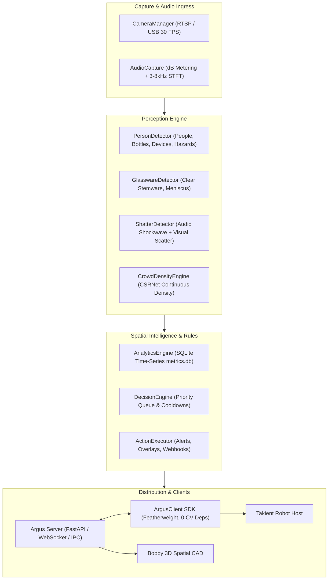

# Argus 👁️

> *"Watch closely. The room tells its own story."*  
> **Autonomous Edge Vision & Multimodal Venue Spatial Intelligence Engine**  
> **Python 3.12 / YOLOv11 / MediaPipe / ONNX Runtime Edge Perception Daemon & Featherweight Client SDK**  
> Real-time crowd density, transparent glassware & cocktail tracking, broken glass hazard detection, and automated spatial telemetry for hospitality and commercial spaces.

[](https://opensource.org/licenses/MIT)
[](https://onnxruntime.ai)
[](#-zero-pii-privacy-invariants)
[](FUTURE_PLANS.md#initiative-1-transparent-glassware--cocktail-vessel-perception)
[](FUTURE_PLANS.md)

---

## 🧠 The 10-Second Mental Model

```
┌──────────────────────────────────────────────────────────────────────────────┐
│ 1. VIDEO & AUDIO INGEST ──> 🎥 USB / IP RTSP stream + 16kHz audio mic        │
│ 2. EDGE INFERENCE       ──> ⚡ YOLOv11 multi-class + TransLab glass rim +    │
│                               CSRNet crowd density + 3-8kHz shatter STFT     │
│ 3. SPATIAL REASONING    ──> 📐 Sliding-window trends, queue latency,         │
│                               and metric homography coordinates              │
│ 4. RULE ARBITRATION     ──> 🛡️ Priority rules with cooldowns & safety guards │
│ 5. TELEMETRY & EMISSION ──> 📡 Streams live JSON telemetry to Robot Host,    │
│                               Bobby CAD 3D maps, and cloud webhooks          │
└──────────────────────────────────────────────────────────────────────────────┘
```

---

## 🏗️ Architecture & Component Topology



---

## 🎯 Which Component Do I Need?

| If You Want To... | Target Component | Technology | Offline? |
| :--- | :--- | :--- | :---: |
| **Run vision intelligence on an edge device / camera** | `services/argus_server` | Python 3.12 / FastAPI / ONNX | **100% Offline** |
| **Integrate detection into Robot Host or custom app** | `clients/python/argus_client` | Python (Zero Heavy CV Deps) | **100% Offline** |
| **Run standalone CLI detection with OpenCV UI** | `src/argus/cli.py` | OpenCV / YOLO / MediaPipe | **100% Offline** |
| **Configure venue occupancy & hazard rules** | `configs/rules/crowd_density.json` | JSON SafeEval Rules | **100% Offline** |

---

## 🚀 Quickstart

### 1. Installation
```bash
# Clone the repository
git clone https://github.com/luisenriquecgongora/argus.git
cd argus

# Install core engine
pip install -e ".[server,audio]"
```

### 2. Run the Detection CLI
```bash
# Launch interactive camera detection with multi-class models
python -m argus.cli --camera 0 --resolution 1280x720 --confidence 0.35
```

### 3. Start the Argus Streaming Server
```bash
# Start edge daemon on port 8100
python -m services.argus_server.main --port 8100
```

### 4. Featherweight Client Usage (e.g. inside `robot_host`)
```python
from argus_client import ArgusClient

# Connect to local or network Argus daemon (0 heavy CV dependencies required!)
client = ArgusClient(host="127.0.0.1", port=8100)
client.connect()

# Stream live telemetry
for telemetry in client.stream_telemetry():
    print(f"People: {telemetry.people_count}, Cocktails: {telemetry.bottle_count}")
```

---

## 🛡️ Zero-PII Privacy Invariants

Argus is engineered ground-up for commercial hospitality and public venues:
1. **On-Edge Face Blurring**: Facial regions are blurred in memory before any frame buffer touches the disk or network.
2. **Zero Biometric Identity Storage**: Patrons are tracked via anonymous bounding-box geometry and centroid trajectories. No facial embeddings or biometric profiles are ever generated or persisted.
3. **Differential Privacy for Aggregate Trends**: Public crowd reports utilize Laplace noise perturbation to prevent individual patron tracking.

---

## 🔬 State-of-the-Art Research Track

Read our comprehensive 10 graduate-level research initiatives in [**FUTURE_PLANS.md**](FUTURE_PLANS.md), including:
- Transparent glassware boundary refraction modeling
- Liquid meniscus segmentation & cocktail fill-level estimation
- Dual-modal audio-visual broken glass fracture detection
- Continuous high-density crowd density regression (CSRNet)
- Multi-camera homography projection into Bobby 3D CAD space

---

## 📄 License
MIT License. Free and open source for commercial and research applications.
