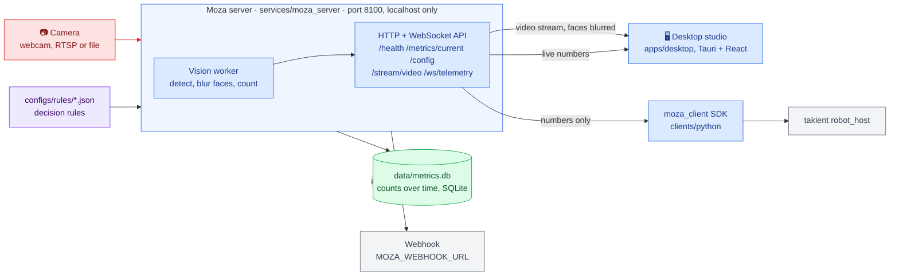
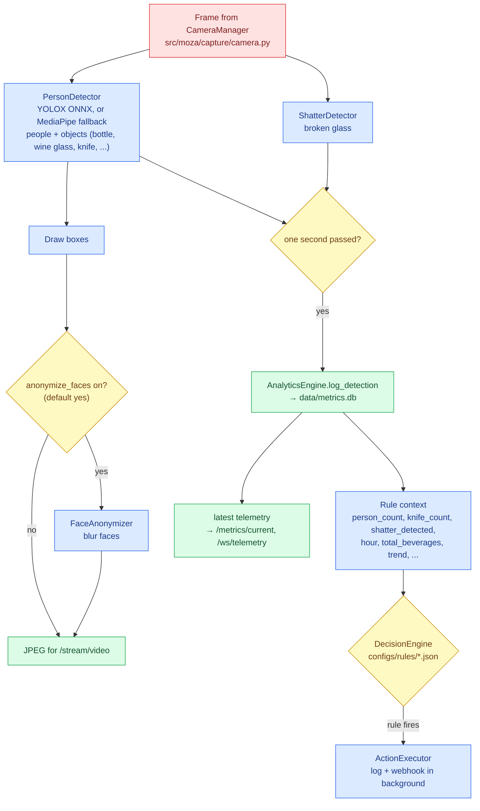
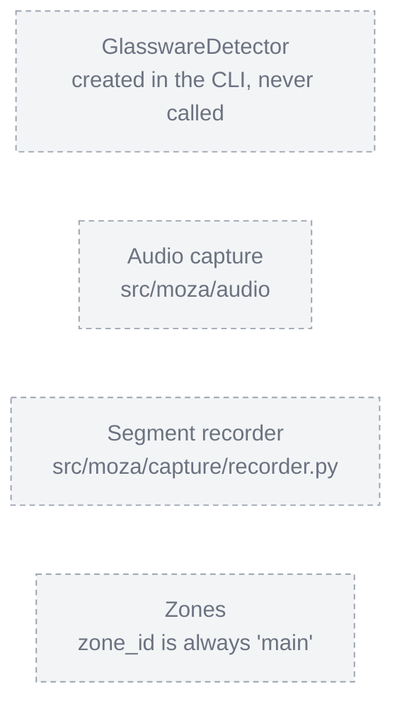

# Architecture

The map of Moza: what its parts are, how a camera frame flows through them, and where to change what.
Keep it current: a change that adds, removes or rewires a part updates the diagram in the same pull request
(`AGENTS.md`, section 11).

## Color palette

| Color | Meaning |
| :--- | :--- |
| 🟦 Blue | Our code: services, packages, apps |
| 🟪 Purple | Inputs: camera, configuration, rule files |
| 🟨 Yellow | Checks, rules and decisions |
| 🟩 Green | Outputs and stored results |
| ⬜ Grey | External systems we do not own |
| 🟥 Red | Personal data: camera frames and video showing people |

## The big picture

Moza watches a venue through a camera, counts people and objects on the venue's own machine, and shares only
the numbers. The server is the hub; the desktop app and other systems read from it.

**Personal data stays on the machine.** Raw frames (red) never leave the server process: the video stream has
faces blurred, and the database, API numbers and webhooks carry counts and alert names only. The server binds
`127.0.0.1` unless started with `--host` / `MOZA_HOST`, and only the desktop app's origins may call it from a
browser (`ALLOWED_ORIGINS`).

## One frame through the server

`background_vision_worker` in `services/moza_server/main.py` runs this loop for every frame:

Rules only see the names in `CONTEXT_KEYS` (`src/moza/rules/decision_engine.py`); a rule using any other name
is skipped when loaded. The fall and empty-glass rules are disabled until a detector provides their values.

## Two ways to run the vision loop

| | Server (`python -m services.moza_server.main`) | CLI (`python -m moza.cli`) |
| :--- | :--- | :--- |
| Used by | Desktop studio, `moza_client`, webhooks | Local testing |
| Detection, broken glass, metrics database | Yes | Yes |
| Decision rules and alerts | Yes | **No** |
| Face blurring | Yes, before anything leaves the loop | 🟥 **No**: shows raw frames in a local window |
| Output | HTTP / WebSocket API | `cv2.imshow` window, log lines |

The two loops are separate code and must change together (see the `review-change` skill).

## Parts

| Part | Folder | What it does | Talks to |
| :--- | :--- | :--- | :--- |
| Capture | `src/moza/capture/` | `CameraManager`: frames from a webcam, RTSP stream or file | Vision loop |
| Detectors | `src/moza/detectors/` | `PersonDetector` (people and objects), `ShatterDetector` (broken glass), `GlasswareDetector` | Vision loop |
| Privacy | `src/moza/privacy/` | `FaceAnonymizer`: blurs faces in a frame | Server loop |
| Analytics | `src/moza/analytics/` | `AnalyticsEngine`: stores counts in SQLite and computes current metrics and trend | `data/metrics.db` |
| Rules | `src/moza/rules/` | `DecisionEngine`: evaluates `configs/rules/*.json` every second | `ActionExecutor` |
| Actions | `src/moza/actions/` | `ActionExecutor`: logs alerts, posts them to the webhook | Webhook |
| Interfaces | `src/moza/core/` | Abstract base classes new parts should implement | — |
| Server | `services/moza_server/` | Runs the vision loop in the background and serves the API | Everything above |
| Desktop studio | `apps/desktop/` | Live video, numbers and settings; calls `127.0.0.1:8100` | Server |
| Client SDK | `clients/python/moza_client/` | Polls `/metrics/current`; no computer-vision dependencies | Server, takient |

## Built but not connected yet

Rules for the bar, entrance, dance floor and VIP zones never fire until zones exist.

## Where to change what

| To change... | Look in | Skill |
| :--- | :--- | :--- |
| What is detected, or add a detector | `src/moza/detectors/`, then both vision loops | `.agents/skills/add-detector` |
| When alerts fire | `configs/rules/*.json`, `CONTEXT_KEYS` | `.agents/skills/add-rule` |
| Where alerts go | `src/moza/actions/executor.py`, `MOZA_WEBHOOK_URL` | `.agents/skills/add-rule` |
| The API | `services/moza_server/main.py`, then `apps/desktop` and `clients/python` | `.agents/skills/review-change` |
| Who may connect | `--host` / `MOZA_HOST`, `ALLOWED_ORIGINS` / `MOZA_ALLOWED_ORIGINS` | `.agents/skills/review-change` |
