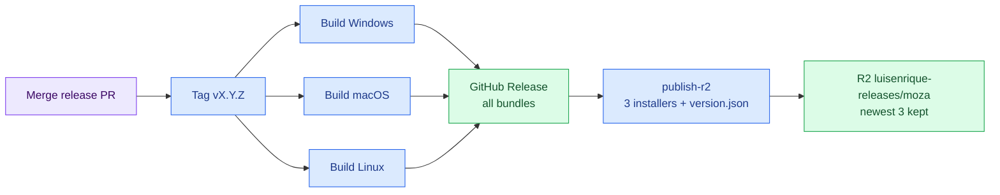

# Releasing Moza Desktop

Moza Studio (`apps/desktop`, a Tauri app) is released for Windows, macOS and Linux. Each release goes to two places:

- **GitHub Releases**: every bundle Tauri builds (`.exe`, `.msi`, `.dmg`, `.app.tar.gz`, `.AppImage`, `.deb`, `.rpm`).
- **Cloudflare R2** (`luisenrique-releases` bucket, shared with Bobby, Emiliano and Yapper): one main installer per platform, so the bucket stays inside the 10 GB free tier.

The Python engine and server are not part of the desktop release; install them with `pip install -e ".[server]"` or Docker (see the README).

## How a release happens

Every push to `main` updates a "chore: release vX.Y.Z" pull request (`release-please.yml`). It bumps the version in `pyproject.toml`, `src/moza/__init__.py`, `apps/desktop/package.json`, `tauri.conf.json` and `Cargo.toml`, and writes `CHANGELOG.md` from the commit types (`feat` = minor, `fix` = patch while below 1.0). Merging that PR tags the release and starts `release.yml`:

1. **`release`** builds the desktop app on Windows, macOS (universal) and Linux with `tauri-action` and attaches every bundle to the GitHub Release.
2. **`publish-r2`** runs after all three succeed: it downloads the setup `.exe`, `.dmg` and `.AppImage`, writes `version.json` (`scripts/publish_release_to_r2.py`), uploads to `moza/vX.Y.Z/` and `moza/latest/`, then keeps only the newest 3 versions (`scripts/prune_r2_releases.py`).

Do not bump versions or tag by hand.


Legend: purple = what you do, blue = workflow steps, green = where the files end up.

## What R2 holds

```text
luisenrique-releases/
└── moza/
    ├── latest/                                 # always the newest release (5 min cache)
    │   ├── Moza-windows-x64-setup.exe
    │   ├── Moza-macos-universal.dmg
    │   ├── Moza-linux-x64.AppImage
    │   └── version.json                        # no-cache
    └── vX.Y.Z/                                 # newest 3 kept, immutable (1-year cache)
        ├── Moza-vX.Y.Z-windows-x64-setup.exe
        ├── Moza-vX.Y.Z-macos-universal.dmg
        ├── Moza-vX.Y.Z-linux-x64.AppImage
        └── version.json                        # version, date, SHA-256 and URLs per platform
```

Public URL: `https://pub-fb9de4da4f48439ebb34b3795d05ab11.r2.dev/moza/latest/version.json`

The cap of 3 cannot be raised or switched off, and a failed prune fails the release; `latest/` is never deleted. Older versions stay on GitHub Releases.

## Secrets

`publish-r2` reads the repository secrets `R2_ACCOUNT_ID`, `R2_ACCESS_KEY_ID`, `R2_SECRET_ACCESS_KEY`, `R2_BUCKET_NAME` and `R2_CUSTOM_DOMAIN`. The release scripts are tested by `python scripts/verify.py --only python`.

## Building locally

```bash
cd apps/desktop
yarn install
yarn tauri build --bundles nsis   # Windows installer in src-tauri/target/release/bundle/nsis/
```

The app icon set in `src-tauri/icons/` is generated from `apps/desktop/app-icon.png` with `yarn tauri icon app-icon.png`.
